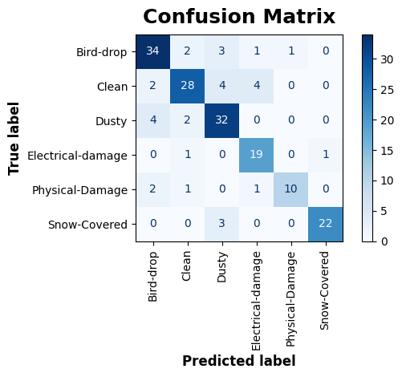

# Solar Panel Defect Classification: An End-to-End Deep Learning Pipeline

[](https://www.python.org/)
[](https://tensorflow.org/)
[](https://keras.io/)
[](LICENSE)

> An end-to-end computer vision pipeline to classify photovoltaic panel conditions across 6 defect classes using transfer learning with **EfficientNetB0**, balanced class weighting, and calibrated fine-tuning.

---

## 1. Project Overview & Headline Results

Automating visual inspection of photovoltaic (PV) modules helps identify physical and electrical faults early, reducing maintenance costs and preventing equipment damage. This project develops a computer vision classifier trained on 885 field-acquired solar panel images across 6 operational classes: `Bird-drop`, `Clean`, `Dusty`, `Electrical-damage`, `Physical-Damage`, and `Snow-Covered`.

### Key Metrics (On 177 Unseen Test Images)

* **Overall Test Accuracy**: **$81.9\%$** ($145 / 177$ correct classifications).
* **Macro F1-Score**: **$0.823$** across all 6 categories.
* **Safety-Critical Fault Detection**: **$90.5\%$ Recall** on `Electrical-damage` (catches $19$ out of $21$ fire hazard defects).
* **Physical Damage Precision**: **$90.9\%$ Precision** on `Physical-Damage` (only 1 false alarm out of all 177 validation images).
* **Generalization Gap**: Held at **$5.21\%$** ($88.26\%$ train vs. $83.05\%$ val), showing healthy fit without severe overfitting.

| Class | Baseline F1 (Phase 5) | Fine-Tuned F1 (Phase 6) | Delta ($\Delta$) | Operational Impact |
| :--- | :---: | :---: | :---: | :--- |
| **Bird-drop** | 0.730 | **0.819** | **+8.9%** | Better recognition of subtle surface drops on glass. |
| **Clean** | 0.771 | **0.778** | +0.7% | Maintained strong baseline accuracy. |
| **Dusty** | 0.824 | **0.800** | -2.4% | Minor trade-off with faint bird-drop patterns. |
| **Electrical-damage** | **0.864** | **0.826** | -3.8% | **90.5% recall preserved** (19/21 defects caught). |
| **Physical-Damage** | 0.737 | **0.800** | **+6.3%** | Precision surged from 83.3% → **90.9%**. |
| **Snow-Covered** | 0.936 | **0.917** | -1.9% | Near-perfect precision (95.7%). |
| **Macro Average** | 0.812 | **0.823** | **+1.1%** | **Balanced multi-class performance lift.** |
| **Overall Accuracy** | 80.8% | **81.9%** | **+1.1%** | Lowest test loss of the project (0.6084). |

> **Note**: Even with `SEED = 42` set, exact numbers may vary slightly across runs due to parallel GPU calculations, asynchronous data loading, and random data augmentations, but overall trends and defect detection results remain identical.

---

## 2. Technical Challenges & Key Design Decisions

Working with real-world solar panel inspection images required addressing several practical computer vision challenges:

1. **Stratified Splitting vs. Random Splitting**:
   - The default `image_dataset_from_directory(validation_split=0.2)` performs a random split, which left minority defect classes with too few validation images for reliable testing.
   - Instead, we used `train_test_split(stratify=all_labels, seed=42)` to enforce an exact 80:20 train-to-validation ratio across every individual class ($708$ train / $177$ validation).
2. **Handling Inconsistent Image Formats**:
   - Exploratory analysis identified 19 RGBA images in the dataset. All images were defensively decoded with 3-channel RGB (`channels=3`) to prevent dimension mismatches.
   - 41 images had extreme aspect ratios ($> 2.0$ or $< 0.5$). We selected full-frame resizing over center-cropping so that defects along panel edges and corners would not be cut off.
3. **Addressing Class Imbalance**:
   - Sample counts ranged from 68 images (`Physical-Damage`) to 207 images (`Bird-drop`).
   - Inverse-frequency class weights were computed and applied during baseline training:
     $$w_c = \frac{N_{\text{total}}}{K \cdot N_c}$$
     This gave minority classes (`Physical-Damage`: $2.15\times$, `Electrical-damage`: $1.44\times$) appropriate penalty weights during loss computation.
4. **Fixing Batch Normalization Drift During Fine-Tuning**:
   - In our first fine-tuning attempt, unfreezing top layers without freezing `BatchNormalization` caused validation loss to increase ($0.66 \rightarrow 0.815$) due to statistic drift under small batch size ($16$).
   - Solution: We kept all `BatchNormalization` layers frozen, unfroze only the top 10 convolutional layers, and lowered the learning rate to $1\times 10^{-5}$. This stabilized training and brought validation loss down to its project low of **$0.6084$**.

---

## 3. Architecture & Tensor Dimensions

The model uses transfer learning with an **EfficientNetB0** backbone:

```text
Input Image: (224, 224, 3)
      │
      ▼
Data Augmentation (Inlined into Model Graph):
   ├─ RandomFlip("horizontal_and_vertical")
   ├─ RandomRotation(0.15)
   └─ RandomContrast(0.20)
      │
      ▼
Pretrained Backbone (EfficientNetB0, ImageNet Weights):
   └─ Feature Map Output: (Batch, 7, 7, 1280)
      │
      ▼
Classification Head:
   ├─ GlobalAveragePooling2D() ──► (Batch, 1280)
   ├─ Dropout(rate=0.20)       ──► (Batch, 1280)
   └─ Dense(6, 'softmax')      ──► (Batch, 6)
```

### Parameter Breakdown
* **Total Parameters**: $4,057,257$
* **Phase 5 (Frozen Baseline)**: $7,686$ trainable weights | $4,049,571$ non-trainable weights.
* **Phase 6 (Fine-Tuning)**: $132,614$ trainable weights | $3,924,643$ non-trainable weights.

---

## 4. Seven-Phase Project Workflow

* **Phase 1: Exploratory Data Analysis (EDA)**
  - Inspected 885 images across 6 categories. Verified file integrity.
  - Checked class frequencies, aspect ratios, and color channel formats.
* **Phase 2: Stratified Data Pipeline**
  - Built a stratified 80:20 split ($708$ train, $177$ val).
  - Configured a `tf.data` pipeline with batch size $16$ and `AUTOTUNE` prefetching.
* **Phase 3: Data Augmentation**
  - Added horizontal/vertical flips, gentle rotation ($15\%$), and contrast adjustments ($20\%$).
  - Integrated augmentations directly inside the model graph so they deactivate automatically during validation (`training=False`).
* **Phase 4: Transfer Learning Architecture**
  - Loaded `EfficientNetB0` without top classification layers.
  - Attached custom pooling, dropout regularization, and 6-class softmax output.
* **Phase 5: Baseline Training & Diagnostics**
  - Compiled with `Adam(lr=1e-3)` and `sparse_categorical_crossentropy`.
  - Trained for 20 epochs with balanced class weights, reaching $80.8\%$ baseline accuracy.
* **Phase 6: Fine-Tuning**
  - Locked all Batch Normalization layers, unlocked the top 10 convolutional layers, and compiled with `Adam(lr=1e-5)`.
  - Trained for 10 additional epochs, reaching a minimum validation loss of **$0.6084$**.
* **Phase 7: Evaluation & Error Analysis**
  - Ran a single-pass synchronized evaluation on all 177 validation samples.
  - Generated the confusion matrix and identified primary sources of error.
  - Visually inspected all 32 misclassified samples to understand edge cases.
  - Saved the final production model as `solar_defect_efficientnetb0.keras`.

---

## 5. Confusion Matrix Analysis & Findings

<p align="center">
  
</p>

### Confusion Matrix (Raw Counts across 177 Validation Images)

| True \ Predicted | Bird-drop | Clean | Dusty | Electrical-damage | Physical-Damage | Snow-Covered |
| :--- | :---: | :---: | :---: | :---: | :---: | :---: |
| **Bird-drop** | **34** | 2 | 3 | 1 | 1 | 0 |
| **Clean** | 2 | **28** | 4 | 4 | 0 | 0 |
| **Dusty** | 4 | 2 | **32** | 0 | 0 | 0 |
| **Electrical-damage** | 0 | 1 | 0 | **19** | 0 | 1 |
| **Physical-Damage** | 2 | 1 | 0 | 1 | **10** | 0 |
| **Snow-Covered** | 0 | 0 | 3 | 0 | 0 | **22** |

Reviewing the final confusion matrix on the 177 validation images showed three main patterns:

1. **High Catch Rate on Severe Defects**:
   - `Electrical-damage`: $19$ correctly identified, $1$ called Clean, $1$ called Snow-Covered. The model did not confuse electrical faults with cracks or bird droppings.
   - `Physical-Damage`: $10$ correctly identified, $2$ called Bird-drop, $1$ called Clean, $1$ called Electrical. Only 1 false alarm across the entire test set.
2. **Surface Soiling Ambiguity**:
   - $4$ `Clean` panels were predicted as `Dusty`; $4$ `Dusty` panels were predicted as `Bird-drop`.
   - *Reason*: On reflective panel glass, subtle dust layers and dried bird droppings can look very similar under bright sunlight.
3. **Busbar Reflection Misinterpretation**:
   - $4$ `Clean` panels were predicted as `Electrical-damage`.
   - *Reason*: Metallic conductive lines (busbars) reflect light at certain angles, creating dark lines that resemble electrical burn marks.

---

## 6. How to Run & Reproduce

### 1. Set Up Environment
```bash
git clone https://github.com/SpiderPig107/solar-panel-defect-classification.git
cd solar-panel-defect-classification

# Create and activate virtual environment
python3 -m venv .venv
source .venv/bin/activate

# Install dependencies
pip install tensorflow numpy pandas matplotlib scikit-learn
```

### 2. Dataset Structure
Place the images in the following folder structure:
```text
solar_pv/
├── Bird-drop/
├── Clean/
├── Dusty/
├── Electrical-damage/
├── Physical-Damage/
└── Snow-Covered/
```

### 3. Run Notebook
Launch Jupyter:
```bash
jupyter lab model.ipynb
```

